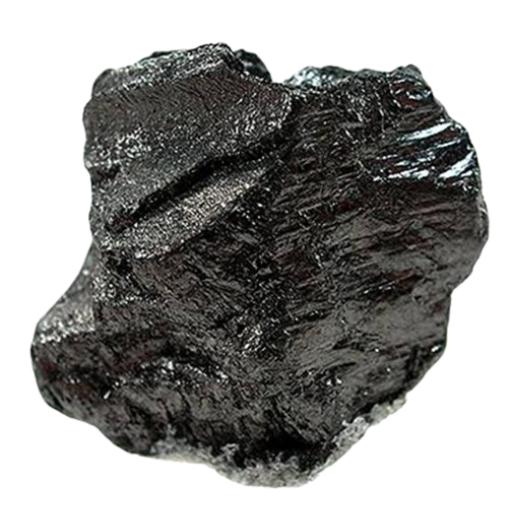
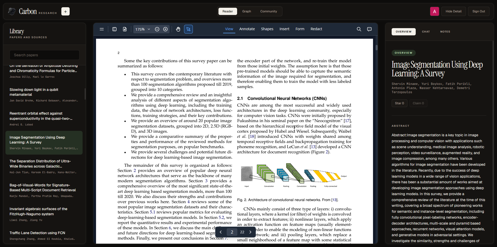

<p align="center">
  
</p>

<h1 align="center">Carbon</h1>

<p align="center">
  Open-source research paper management.
  Import papers, understand them faster, map how they connect, and chat with your library.
</p>

<p align="center">
  <a href="#showcase">Showcase</a> |
  <a href="#features">Features</a> |
  <a href="#quick-start">Quick Start</a> |
  <a href="#deploy-to-cloudflare">Deploy</a> |
  <a href="#free-plan-notes">Free Plan Notes</a>
</p>

## Overview

Carbon turns arXiv links, PDFs, and research pages into a personal research workspace. It extracts metadata, stores papers in a shared library on Cloudflare D1 and R2, generates AI summaries, builds a similarity graph, and lets you ask grounded questions about each paper.

The app is built with Next.js 16 and React 19, runs on Cloudflare Workers via OpenNext, and uses D1, R2, Vectorize, Workers AI, OpenRouter-hosted LLM calls, Sigma.js graph rendering, and an embedded PDF reader.

## Showcase

<p align="center">
  
</p>

## Features

- Import arXiv URLs, direct PDF links, or generic paper pages with streaming progress.
- Store a personal paper library with per-user read state, notes, sorting, and filtering.
- Generate structured AI summaries.
- Build paper-to-paper similarity edges with embeddings stored in Cloudflare Vectorize.
- Explore an interactive WebGL knowledge graph powered by Sigma.js and Graphology.
- Read PDFs in-app through a proxy route that avoids common external CORS issues.
- Chat with individual papers using extracted paper text, summary, and library context.
- Sign in with Google, public profiles, follows, stars, claims, and a community activity feed.

## Tech Stack

| Area | Technology |
| --- | --- |
| App | Next.js 16 App Router, React 19, TypeScript |
| Hosting | Cloudflare Workers via `@opennextjs/cloudflare` |
| Styling | Tailwind CSS 4, custom global CSS, Next fonts |
| Auth | Google OAuth (hand-rolled), sessions in D1, HttpOnly cookie |
| Data | Cloudflare D1 (SQLite), R2 (PDFs and cached text), Vectorize (embeddings) |
| AI | OpenRouter chat completions and embeddings |
| Papers | Workers AI `toMarkdown` for PDF/HTML text, `HTMLRewriter`, arXiv scraping |
| Graph | Sigma.js, Graphology, ForceAtlas2, no-overlap layout |
| Reading | `@embedpdf/react-pdf-viewer`, KaTeX, Markdown rendering |

## Quick Start

### Prerequisites

- Bun.
- A Cloudflare account (the free Workers plan is enough). The `wrangler` CLI is installed as a dev dependency; run `bunx wrangler login` once.
- A Google Cloud OAuth 2.0 client (type "Web application").
- An OpenRouter API key.

### Install

```bash
bun install
```

### Google OAuth

In the Google Cloud console, create an OAuth client and add these authorized redirect URIs:

```txt
http://localhost:3000/auth/callback
http://localhost:8787/auth/callback
https://<worker>.<subdomain>.workers.dev/auth/callback
```

Add your custom domain's `/auth/callback` too if you use one.

### Configure Secrets

Local secrets live in `.dev.vars` (gitignored), which both `bun dev` and `wrangler` read:

```bash
cp .dev.vars.example .dev.vars
```

```env
NEXTJS_ENV=development
OPENROUTER_API_KEY=your-openrouter-api-key
GOOGLE_CLIENT_ID=your-google-oauth-client-id
GOOGLE_CLIENT_SECRET=your-google-oauth-client-secret
AUTH_SECRET=random-32-byte-hex-or-base64-string
```

Generate `AUTH_SECRET` with e.g. `openssl rand -hex 32`.

### Run Locally

Apply the database migrations to the local D1 database, then start the dev server:

```bash
bun run db:migrate:local
bun dev
```

Open the app at:

```txt
http://localhost:3000
```

`bun dev` uses local simulations of D1 and R2. Workers AI (`toMarkdown`) always runs against your Cloudflare account, so it needs `wrangler login`; Vectorize has no local simulation, so similarity edges are skipped during local development.

To test the real Workers runtime build locally:

```bash
bun run preview
```

This serves the app at `http://localhost:8787`.

## Deploy to Cloudflare

Create the resources once:

```bash
bunx wrangler d1 create carbon
bunx wrangler r2 bucket create carbon-papers
bunx wrangler vectorize create carbon-paper-vectors --dimensions=1536 --metric=cosine
```

Paste the `database_id` printed by `d1 create` into `wrangler.jsonc` (replacing `REPLACE_WITH_D1_DATABASE_ID`).

Set the secrets:

```bash
bunx wrangler secret put OPENROUTER_API_KEY
bunx wrangler secret put GOOGLE_CLIENT_ID
bunx wrangler secret put GOOGLE_CLIENT_SECRET
bunx wrangler secret put AUTH_SECRET
```

Apply migrations and deploy:

```bash
bun run db:migrate:remote
bun run deploy
```

After changing bindings in `wrangler.jsonc`, regenerate the binding types with `bun run cf-typegen`.

## Free Plan Notes

Carbon is designed to fit the Cloudflare Workers free plan:

- **CPU:** 10 ms of CPU time per request. Heavy work (PDF/HTML to text) is offloaded to Workers AI `toMarkdown` and `HTMLRewriter`; waiting on network calls does not count.
- **Subrequests:** 50 per request (including D1, R2, and `fetch`), so imports are limited to **5 URLs at a time**.
- **Vectorize:** 1536-dimension embeddings fit roughly 3,200 papers within the free stored-dimensions quota.
- **Workers AI:** 10,000 neurons per day, shared by all `toMarkdown` conversions.

## Usage

1. Sign in with Google.
2. Paste up to five arXiv, PDF, or paper page URLs into the import flow.
3. Select a paper to read metadata, notes, PDF content, and community state.
4. Run enrichment to stream summaries and graph connections.
5. Switch to the graph view to explore related papers.
6. Open the chat tab to ask paper-specific questions grounded in extracted text.

## License

MIT
